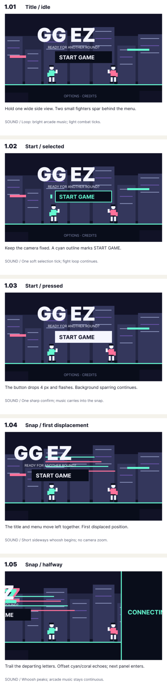
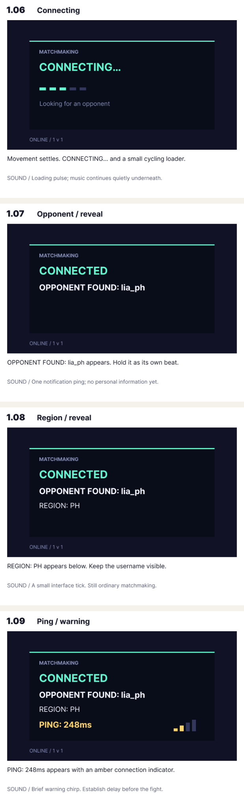
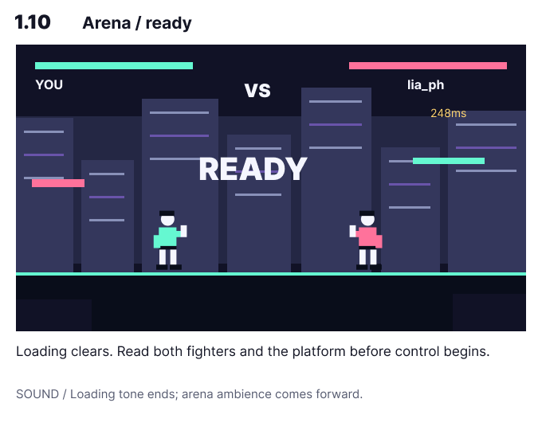

# Scene 1: the title screen, ten editable beats

**Built in Figma; not implemented in Godot.** This is a separate adaptation of Scene 1 from the [recovered complete v0.3 master](../recovered/RECOVERED-Complete-Game-Storyboard-v0.3.md), not a replacement for the thirteen-scene story. The ten-frame breakdown is user-approved. Styling, transitional poses and sound cues below are storyboard proposals.

[Open the editable board](https://www.figma.com/design/9n83sdzD1t2Fm3asaMi1Hs/GG-EZ?node-id=33-2) · [Reusable fighter shapes](https://www.figma.com/design/9n83sdzD1t2Fm3asaMi1Hs/GG-EZ?node-id=33-7)

## Read on a phone

The three previews contain all ten frames, with action and sound notes. These are lossless PNG screenshots inside SVG carriers because the direct GitHub MCP file tools accept text, not binary uploads. The Figma source remains native and editable.

- [1–5: menu and sideways snap](scene-01-menu-snap.svg)
- [6–9: connecting, opponent, region, ping](scene-01-matchmaking.svg)
- [10: arena reveal](scene-01-arena.svg)

## What stays fixed

- Lapu-Lapu City, Cebuano / Bisaya with English translations remains the latest locale direction. These opening screens have no spoken dialogue, so none is invented here. Quezon City / Tagalog wording remains untouched in the recovered source archive.
- Start bright and playful. No ghost, room, hardship clue, controller throw or monitor crossing appears in Scene 1. Do not advertise the later emotional turn.
- Use one fixed side-view camera. The title/menu moves horizontally; the camera does not pan or zoom during the snap. Keep two small fighter silhouettes on a clearly separated platform.
- Preserve the menu text: `GG EZ`, `READY FOR ANOTHER ROUND?`, `START GAME`, `OPTIONS · CREDITS`.
- Preserve the loading sequence: `CONNECTING...`, `OPPONENT FOUND: lia_ph`, `REGION: PH`, `PING: 248ms`. Figma typesets the connecting ellipsis as one glyph. The ping is a story value, not a measured live connection.

## Screen-by-screen handoff

Durations are adjustable rehearsal values, not recovered facts or production deadlines. The original source marks Scene 1 as an interactive menu within approximately 00:00–00:30. Player input determines its actual duration. Do not force a thirty-second wait.

| Frame | Text and action | Camera / movement | Sound | Draft hold / exit |
|---|---|---|---|---|
| [1.01](https://www.figma.com/design/9n83sdzD1t2Fm3asaMi1Hs/GG-EZ?node-id=33-41) Title idle | Complete menu. Fighters spar behind it; no selection highlight. | Fixed wide side view. Small fighters, deep city, unbroken ground line. | Energetic arcade loop and light combat ticks. | Until selection input. |
| [1.02](https://www.figma.com/design/9n83sdzD1t2Fm3asaMi1Hs/GG-EZ?node-id=33-111) Start selected | Cyan outline, label and left cursor identify START GAME. | Same composition. Background sparring continues. | One selection tick, not a repeating sound. | Until confirm or selection changes. |
| [1.03](https://www.figma.com/design/9n83sdzD1t2Fm3asaMi1Hs/GG-EZ?node-id=33-182) Start confirmed | Button drops four pixels and flashes light. | Camera and menu stay still for the press response. | Sharp confirm. Music continues. | Try 0.12 s before the snap. |
| [1.04](https://www.figma.com/design/9n83sdzD1t2Fm3asaMi1Hs/GG-EZ?node-id=33-257) Snap starts | Title, subtitle and Start move left together. First horizontal trails appear. | First displaced position: 95 px left in the 640 px storyboard view. No zoom or fade. | A short sideways whoosh begins. | First portion of a proposed 0.30 s total snap. |
| [1.05](https://www.figma.com/design/9n83sdzD1t2Fm3asaMi1Hs/GG-EZ?node-id=33-330) Snap midpoint | Departing letters trail with cyan/coral echoes. The connecting panel enters from the right. | Title displaced 330 px; incoming edge at x=472. This is a motion key pose, not a frame intended for prolonged reading. | Whoosh peaks, arcade loop unbroken. | Continue directly into the settled loading view. |
| [1.06](https://www.figma.com/design/9n83sdzD1t2Fm3asaMi1Hs/GG-EZ?node-id=33-413) Connecting | CONNECTING… plus cycling cells. “Looking for an opponent” is added interface copy, not recovered dialogue. | Fixed isolated interface on dark field. | Quiet loading pulse. | Actual connection wait; in rehearsal, try at least 0.4 s for readability. |
| [1.07](https://www.figma.com/design/9n83sdzD1t2Fm3asaMi1Hs/GG-EZ?node-id=33-430) Opponent | OPPONENT FOUND: lia_ph appears. Status changes to CONNECTED. No personal information. | Same panel and camera. | One notification ping. | Try 0.4 s before adding the region. |
| [1.08](https://www.figma.com/design/9n83sdzD1t2Fm3asaMi1Hs/GG-EZ?node-id=33-442) Region | REGION: PH appears below the unchanged username. | Same panel. One new line, no reflow. | A small interface tick. | Try 0.4 s before adding the connection warning. |
| [1.09](https://www.figma.com/design/9n83sdzD1t2Fm3asaMi1Hs/GG-EZ?node-id=33-455) Ping | PING: 248ms and amber connection bars. Earlier lines remain visible. | Same panel. Amber is reserved for the new warning. | Brief warning chirp. | Try 0.6 s before the arena reveal. |
| [1.10](https://www.figma.com/design/9n83sdzD1t2Fm3asaMi1Hs/GG-EZ?node-id=33-478) Arena reveal | Loading clears. YOU, lia_ph, health bars, READY and the ping indicator are visible. These arena labels are adaptation details. | Return to the wide side view. Read both fighters and the platform before handing over control. | Loading tone ends; arena ambience comes forward. | Try 0.5 s, then hand into Scene 2. Do not add another fight frame here. |

## SANABI composition references

The [existing reference desk](https://www.figma.com/design/9n83sdzD1t2Fm3asaMi1Hs/GG-EZ?node-id=7-3) contains official Steam screenshots credited to WONDER POTION / NEOWIZ. They are composition studies, not GG EZ artwork and not a permission-cleared training dataset. No SANABI screenshot is used as a fill in the new board.

- **Menu, 1.01–1.03: S02.** Tiny figures against a lit city; dark foreground kept distinct from background detail.
- **Snap, 1.04–1.05: S03.** Readable movement across a horizontal axis. The colored trails are our blocking proposal, not a copied SANABI asset.
- **Matchmaking, 1.06–1.09: S05.** A bounded cyan interface against darkness. This is an explicit new application to v0.3 Scene 1; the older reference document mapped S05 to phone/work screens.
- **Arena, 1.10: S01 + S02.** Two-character scale and enough empty space to read their relationship. The opening remains an arcade scene, not an emotional reveal.

See [director research](../../SANABI_DIRECTOR_RESEARCH.md) and [source URLs](../../VISUAL_REFERENCES.md). Their older scene mappings are historical; this section is the Scene 1 mapping for the recovered thirteen-scene master.

## Editable structure and remaining art work

Board `33:2` is placed at x=8960, y=2240, outside all previous board bounds. Read down each of four columns, then right. Each numbered card contains one 640×360 screen plus action and sound notes. The source has **ten screen frames, 111 text layers, 371 rectangles, twelve fighter instances, and twelve ellipses** (including instance descendants). There are **zero image fills**. Two local silhouette components sit separately below the board. Typeface: Inter, matching the existing reference desk, not a claim about Godot's unspecified default font.

The silhouettes and city are blocking shapes. Final character art, combat animation, city art, sound selection, controller focus behavior, real matchmaking states, lost-connection/error screens and reduced-motion behavior remain game-implementation work. The approved ten-frame storyboard does not silently expand to cover those paths. The script is not Code Connect; the repository has no Code Connect mapping.

`scene-01-build.js` records the construction. Run only in the Figma MCP `use_figma` context with both `figma-use` and `figma-generate-design` skills loaded. It refuses an existing board with the same name instead of duplicating it; use targeted edits for revisions. Do not run it as Node.js or paste it into the Godot runtime.

## Verification

- Native hierarchy, exact staged text and ten screen frames inspected through Figma MCP.
- Full-board screenshot and all three phone crops visually inspected. Notes fit inside their cards; the intentional partial words in the snap midpoint convey movement.
- Existing reference section and two earlier boards retained at their original IDs, positions and sizes. The build code performs no modifications to them.
- No recovered story or runtime files changed. This handoff and its source/preview assets are additive; `BETWEEN_ROUNDS.md` gains a link.
- One composition build took 5.38 s end-to-end locally, including the short-lived Figma MCP client process. That is not a Figma rendering benchmark. Cropping took 0.36 s and about 121 MiB peak process memory. Work and storage scale with ten screens and the exported image; no background service is installed.
