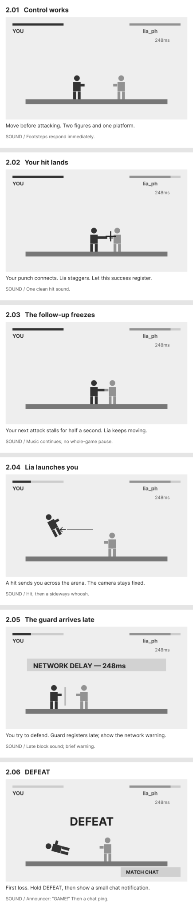
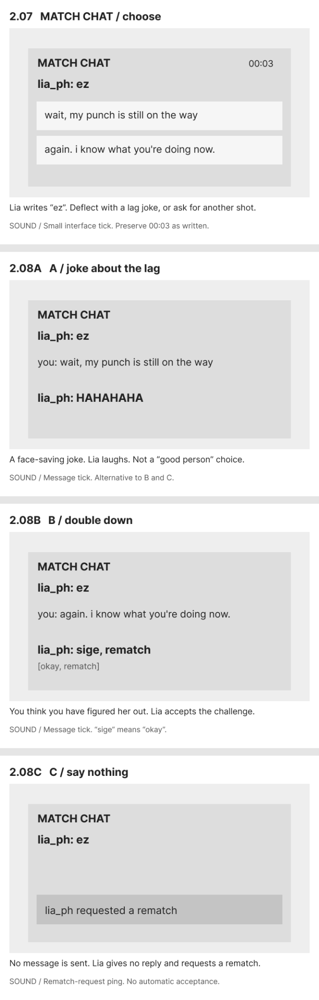

# Scene 2: The first humiliation (graybox)

Editable Figma: https://www.figma.com/design/9n83sdzD1t2Fm3asaMi1Hs/GG-EZ?node-id=58-134

Carl approved the table and asked for simple grayboxing, not detailed art. This revision replaces the original nice/rude chat choice with two distinct reactions to losing. All recovered source files and Scene 1 are unchanged. Only Scene 2 is built; subsequent losses and transport are proposals awaiting table review. The Godot runtime is unchanged.

## Screens

| Frame | On screen | Action / sound |
|---|---|---|
| 2.01 | Two figures, a platform, health bars | Movement responds normally. |
| 2.02 | Your hit connects; Lia staggers | One clear hit before any unfairness. |
| 2.03 | Your next attack pose hangs | Your character freezes for half a second; the world does not pause. |
| 2.04 | Lia launches you across the arena | Knockback, fixed side-view camera. |
| 2.05 | Late guard; `NETWORK DELAY — 248ms` | Defense arrives too late. |
| 2.06 | `DEFEAT`, followed by a chat notification | Announcer: `GAME!`; then notification ping. The static frame depicts the result and ensuing notification; it is not an animation. |
| 2.07 | `MATCH CHAT`, `00:03`, `lia_ph: ez`, two replies | Choose how to handle the embarrassment. |
| 2.08A | `you: wait, my punch is still on the way` → `lia_ph: HAHAHAHA` | Deflect with a lag joke. |
| 2.08B | `you: again. i know what you're doing now.` → `lia_ph: sige, rematch` | Double down. English translation: “okay, rematch”. |
| 2.08C | No player message; rematch request | Silence. Lia gives no reply and requests a rematch. |

A, B and C are mutually exclusive alternatives, not three consecutive exchanges. There is no third clickable “silence” button. `00:03` is retained without inventing whether the original intended elapsed time or a countdown. No auto-acceptance is shown in the silence branch.

## Why revise the choice

The previous pair, “wow, you're good” and “fuck you”, mostly asked the player to choose between polite and rude. The new pair gives the protagonist two ways to protect their pride: turn the delay into a joke, or claim they have figured Lia out. Neither is marked as good or bad. These are newly drafted lines approved for exploration by Carl's request to revise the boring choice, not recovered quotations.

The archived original mapping remains untouched: compliment → “ty boss 😭”, insult → “HAHAHAHA”, silence → no reply/rematch. The new challenge reply “sige, rematch” is an adaptation using Cebuano/English gaming speech. The bracketed English line in the graybox is a translation annotation, not another message sent by Lia.

## Phone screenshots

These are lossless screenshots of the actual native Figma frames. SVG is only a carrier for the PNG bytes; editable source remains in Figma.

### First fight, 2.01–2.06

### Chat and alternative outcomes, 2.07–2.08C

## Scope and continuity

- Simple gray figures, one floating platform, plain interface boxes and labels. No detailed environments, finished sprites, particle polish or prototype interaction wiring.
- Camera stays side-on. Figure poses, health-bar lengths and unspecified sounds are staging suggestions, not game-balance specifications.
- Native rectangles, ellipses, frames and text. No screenshot fills or imported artwork. Existing Inter typography reused; no new typeface dependency.
- Earlier SANABI composition studies informed the fixed side view and readable spacing only. No SANABI artwork is copied. Credit: WONDER POTION / NEOWIZ.
- Latest story locale stays Lapu-Lapu City, Cebuano/Bisaya with English translations. Do not replace archived Quezon City/Tagalog records.
- There is no second/third loss, controller throw, crack, portal, ghost, or room sequence in this deliverable.
- Native source: [scene-02-graybox.js](scene-02-graybox.js). Requires the existing Figma file and loaded Inter Regular/Bold. It refuses an existing Scene 2 board rather than duplicating work; revise the real board by targeted edits.
